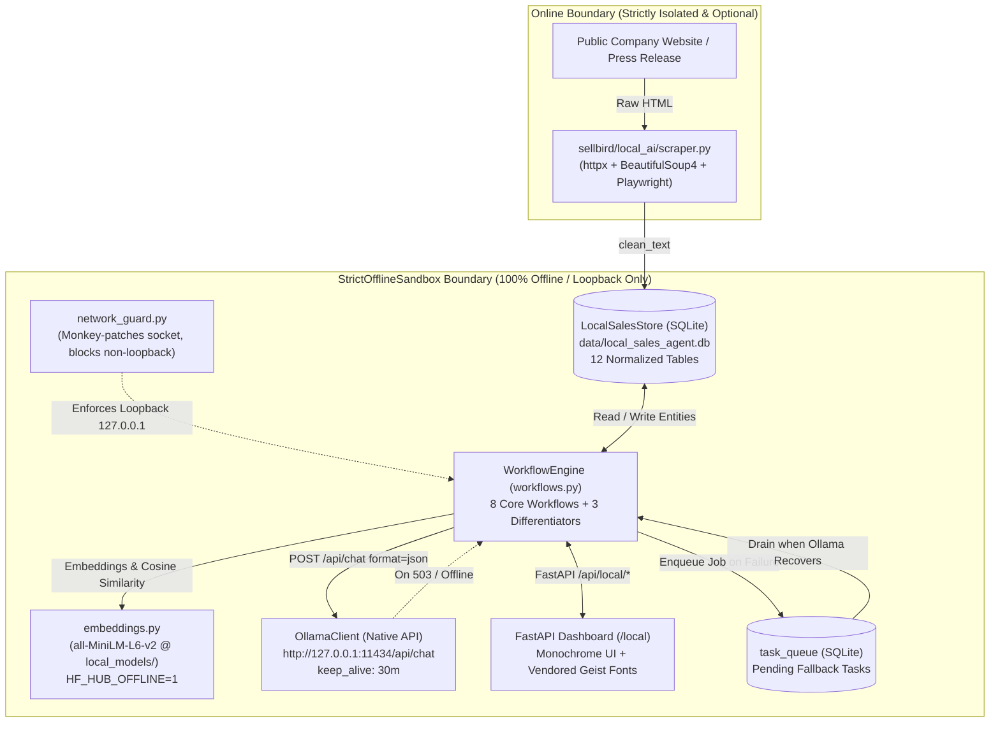
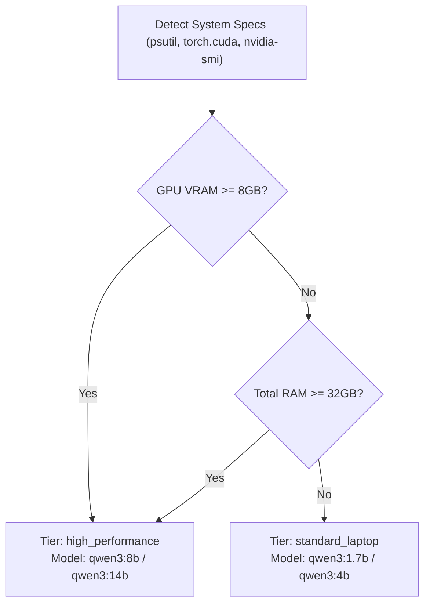
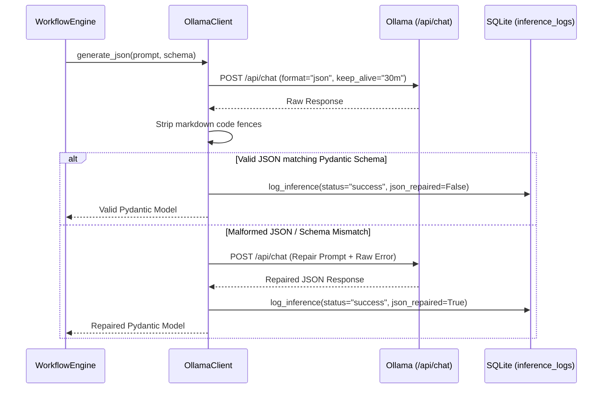
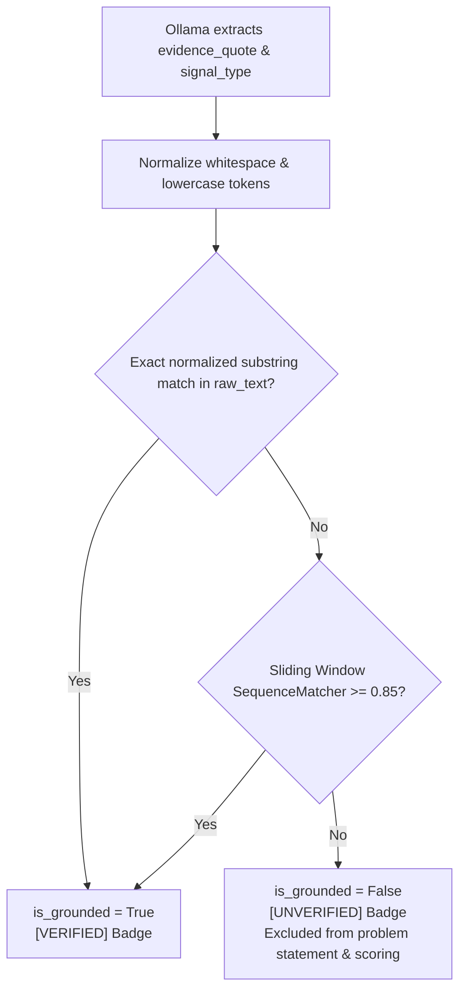

# Technical Architecture — Harvey AI Sales Agent (Local)

## 1. System Overview & Offline Boundary

Harvey AI Local is an air-gapped, sovereign, multi-product B2B sales automation engine. It replaces all external LLM SaaS providers (OpenAI, Anthropic, Gemini), CLI wrappers, and third-party enrichment vendors with a 100% private, local architecture.



---

## 2. Hardware Profiling & Adaptive Tiering

Hardware detection in `sellbird/local_ai/hardware.py` executes dynamically on startup without crashing CPU-only machines:
- **CPU Cores & System RAM:** Detected via `psutil.cpu_count(logical=True)` and `psutil.virtual_memory()`.
- **GPU VRAM:** Detected via `torch.cuda` (if PyTorch is installed with CUDA), falling back to `nvidia-smi` subprocess parsing. Safely catches `FileNotFoundError` on non-NVIDIA/CPU-only laptops.

### Decision Matrix

| Tier | Hardware Criteria | Recommended Model | Fallback Models | Target Persona |
| :--- | :--- | :--- | :--- | :--- |
| **Standard Laptop** | Dedicated GPU < 8GB VRAM OR Total RAM < 16GB | `qwen3:1.7b` / `qwen3:4b` | `qwen2.5:1.5b`, `llama3.2:3b` | MacBooks, ultrabooks, CPU laptops |
| **High Performance** | Dedicated GPU >= 8GB VRAM OR Total RAM >= 32GB | `qwen3:8b` / `qwen3:14b` | `qwen3:8b`, `mistral:7b` | Workstations, GPU instances |



---

## 3. Native Ollama Client & JSON Repair Loop

Small local LLMs (1.7B–4B) can occasionally output trailing commas, unescaped characters, or accidental Markdown code fences (` ```json `).

`OllamaClient` handles this through a 3-layer resilient pipeline:
1. **Markdown Fence Stripping:** Regex strips leading ````json` and trailing ````.
2. **Pydantic Model Validation:** Parses JSON directly into strict Pydantic models.
3. **Automatic 1-Shot Repair:** If `ValidationError` or `json.JSONDecodeError` occurs, an immediate repair prompt is issued to Ollama (`POST /api/chat` with `format="json"`) specifying the exact syntax error.
4. **Structured Inference Logging:** Every attempt records latency, eval token count, tokens/sec, and `json_repaired: bool` to both [logs/local_inference.jsonl](file:///c:/Users/malla/OneDrive/Desktop/projects/Harvey-AI-Sales-Agent-Local/logs/local_inference.jsonl) and SQLite `inference_logs`.



---

## 4. Engineering Differentiator 1: Multi-Product Fit Matrix

Most AI sales tools only pitch one product at a time. Harvey AI Local evaluates each prospect against the company's entire multi-product catalog:
1. Loads prospect `raw_text` from SQLite.
2. Generates local 384-dimensional dense vector embedding using `sentence-transformers/all-MiniLM-L6-v2` (`HF_HUB_OFFLINE=1`).
3. Compares against pre-computed ICP embeddings for all products via cosine similarity:
   $$\text{similarity} = \frac{\mathbf{u} \cdot \mathbf{v}}{\|\mathbf{u}\|_2 \|\mathbf{v}\|_2}$$
4. Product with highest similarity becomes `primary_product_id`.
5. Products with similarity above threshold ($\ge 0.35$) are assigned as `cross_sell_product_ids`.
6. Stored in `product_fit_matrix` table in SQLite.

---

## 5. Engineering Differentiator 2: Anti-Hallucination Evidence Grounding

Small local models can hallucinate quotes when summarizing long text. We enforce an air-tight deterministic Python verifier:



`verify_quote_grounding(quote, raw_text)` prevents unverified claims from contaminating the generated problem statement and outreach email.

---

## 6. Engineering Differentiator 3: Failure Handling, Fallbacks & Durable Queue

When Ollama is offline or restarting:
1. **Never Fall Back to External Clouds:** Zero data is transmitted over the internet.
2. **Execute Deterministic Fallbacks:**
   - Buying signals: regex keyword scanning (`cost_pressure`, `compliance_audit`, `tech_migration`, `funding`, `hiring`).
   - Product fit: 100% operational offline via `all-MiniLM-L6-v2`.
   - Scoring: deterministic embedding fit + grounded signal weight score.
   - Email: template-based draft using verified evidence quote.
   - Reply triage: regex intent classifier.
3. **Queue Task in SQLite:** Inserts job into `task_queue` with status `'pending'`.
4. **Return HTTP 503:** Informs client and surfaces UI offline banner.
5. **Durable Queue Draining:** When Ollama recovers, calling `POST /api/local/queue/process` drains the queue sequentially and transitions tasks to `'completed'`.
